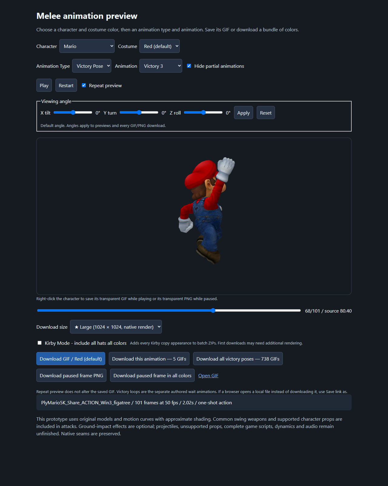
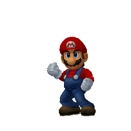
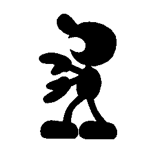
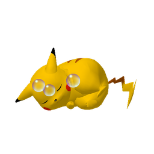

# Melee Animation Studio

Turn Super Smash Bros. Melee animations into transparent GIFs and PNGs. This Windows tool builds on the Melee decompilation: import assets from your own game ISO, choose a character and costume, play an animation, rotate the view, and download the animation or a single paused frame.

> [!WARNING]
> **Plan for roughly 40 GB — FORTY GIGABYTES — of local project data.** That is the author's current estimate, including generated assets, rather than the size of the source download. Importing and rendering creates extracted files, PNG frames, GIFs, ZIP bundles and caches. More animations, Kirby hats, viewing angles and larger native renders increase it further; the 1024px rebuild will change this estimate. Leave additional free space for preparation and downloads.



## What you can make

- Transparent animated **GIFs**, or **PNG stills** from the exact frame you pause on.
- The selected costume, every actual costume color, or a matching animation across characters.
- Victory poses, taunts, clapping, attacks, movement, sleep, rolls and knockdowns. Zelda and Sheik are separate entries; Ice Climbers render together.
- Kirby with any supported copy hat or replacement body, in each of his six colors.
- Views rotated on the X, Y and Z axes, with the same angle in your downloads.

The roster also includes Giga Bowser, both wireframes, Master Hand, Crazy Hand and Sandbag. Selected attacks include held items, character props and special effects. Multipart moves have combined playback presets, with their individual phases hidden by default. Lighting, effects and some runtime behavior remain approximate. **MP4 export is still future work.**

| Victory pose | Clapping | A paused frame |
| --- | --- | --- |
|  |  |  |

These examples come from the actual renderer and are downsampled for this README. Full-resolution exports are generated locally from your ISO.

## Set up on Windows

### 1. Download the repository and install Python

Download and extract the entire repository, or clone it with Git. Keep its folders together and run it from the extracted folder, rather than inside a ZIP.

Install **64-bit Python 3.13** from [Python's Windows downloads](https://www.python.org/downloads/windows/), enabling **Add Python to PATH**. Setup accepts Python 3.10–3.13; Python 3.13 is the tested choice. Use a normal browser such as Edge, Chrome or Firefox.

The import launcher installs **NumPy 2.2.4** and **Pillow 11.1.0** into this checkout's `.venv` if matching packages are not already available. Internet access is needed for the first package installation. Versions are pinned in [requirements.txt](tools/melee_anim/requirements.txt).

**Blender, Dolphin, FFmpeg, Node and a game compiler are not needed for the current UI or GIF/PNG exports.** The renderer uses Windows OpenGL. Node is only used for developer tests.

### 2. Put your ISO in the root folder

Name your own game dump **`melee.iso`** and place it beside this README:

```text
melee-decomp-animations/
    README.md
    Import Melee Iso.cmd
    Open Melee Decomp Animation UI.cmd
    melee.iso                         <- your game dump
    tools/
    src/
    config/
```

Enable **File Explorer → View → Show → File name extensions** to check that the name is `melee.iso`, rather than `melee.iso.iso`.

The importer requires **NTSC-U Melee 1.02 / GALE01 revision 2**, with executable SHA-1 `08e0bf20134dfcb260699671004527b2d6bb1a45`. It checks the executable before extraction. Use a raw ISO/GCM image; compressed RVZ/GCZ/NKit images are unsupported. Changing their filename extension does not convert them.

The ISO and bulk extracted/rendered assets are ignored by Git and stay on your computer. Game files are not supplied with this repository.

### 3. Double-click “Import Melee Iso”

Open **[Import Melee Iso.cmd](Import%20Melee%20Iso.cmd)** in File Explorer. There is no separate extraction app to install or open. The progress window:

1. Verifies and extracts the ISO into `orig/GALE01/files` and `orig/GALE01/sys`.
2. Prepares the Python packages and character/costume/action catalogs.
3. Renders the original 984 victory/taunt/clapping costume previews and 123 synchronized claps.
4. Builds the player and download bundles, then verifies the outputs.

**The first build takes considerable time and disk space.** Leave the window open until **“Import complete”** appears. Additional actions and variants render on demand when selected or downloaded. If preparation fails or is interrupted, fix the reported issue and run the same launcher again; completed matching jobs are reused.

To extract only, open PowerShell in the repository folder and run:

```powershell
& '.\Import Melee Iso.cmd' --extract-only
```

Extraction alone does not prepare the UI. Run the full import afterward.

### 4. Double-click “Open Melee Decomp Animation UI”

Open **[Open Melee Decomp Animation UI.cmd](Open%20Melee%20Decomp%20Animation%20UI.cmd)**. It starts or reuses this checkout's local server and opens **[http://127.0.0.1:8765/player.html](http://127.0.0.1:8765/player.html)** in your browser.

Use this shortcut each time you want the UI. It does not import the ISO or rebuild the entire collection. The background server keeps running after its launcher window closes; a later launch starts it again if necessary.

## Use the player

Choose **Character**, optional **Kirby Power**, and **Costume**, then **Animation Type** and **Animation**. The animation selector appears when the type offers multiple choices. **Hide partial animations** starts checked; uncheck it to see combined moves alongside their separate phases.

**Repeat preview** starts on. Pause or scrub to a frame, then download its PNG. Right-clicking the preview saves the GIF while playing or the exact PNG while paused. Adjust the X/Y/Z sliders and click **Apply** to render a different view; **Reset** returns to the original angle. New views are cached after rendering.

| Option | What it does |
| --- | --- |
| Clapping modes | Original animation, minimum cycle, dirty/jittery cut, or the 0.84-second clapping-sync alteration. |
| Ground-impact effects | Fits the complete Knockdown impact when on; zooms in to fit the character alone when off. Fighter flashes remain. |
| Keep character centered | Follows full/short hops without changing their source poses or timing. |
| Download all colors | Saves the selected animation in every actual costume variant. |
| Download All | Victory Pose includes all three entrances and waits across characters/colors. Clapping and Taunt stay within their type. Attacks use the matching move family, including grounded/aerial versions and combined moves where available. |
| Kirby Mode - include all hats all colors | Adds every Kirby appearance and all six colors to batch ZIPs. Individual downloads retain the selected appearance. |

Batch buttons show a spinner while preparing files and prevent duplicate requests. Large first-time batches may need substantial additional rendering.

## Resolution and storage choices

I chose **512 × 512 as the native render size for most animations** to balance project size with useful image quality. I chose **1024 × 1024 for taunts, victory poses and clapping**, because those are the images I expect to use most myself. Synchronized claps and rotated/Kirby versions follow the same type-based policy.

Downloads offer **128, 256, 512, 1024 and 2048px** square images. A **★** marks the selected type's native size: **512 for most types, 1024 for Taunt, Victory Pose and Clapping**. Smaller exports downsample. Larger exports upscale the native image, adding dimensions without extra detail. The UI explains upsizing and shows a dark-yellow large-GIF warning for 2048px.

To make a smaller collection—or spend the same space on higher native resolution—limit the characters, actions, colors and cached views you render. Rendering Kirby's 25 copied appearances in all six colors adds **150 extra appearance/color variants per animation**, so omitting unneeded hats can save substantial space. The current estimate is about **40 GB**, and higher-resolution builds will increase it. CLI render commands accept `--size` for custom builds; keep custom outputs separate from the standard player collection unless you also update its resolution policy.

## Troubleshooting and manual setup

- **Python not found:** install 64-bit Python 3.13 with PATH enabled. Shortcuts search `.venv`, then `py -3.13`, then `python`.
- **Packages fail to install:** check your internet connection and the error in the import window. If `.venv` uses incompatible Python, rename it and run import again.
- **ISO rejected:** check its filename, location, raw image format and revision. The importer reports the reason.
- **Animations not prepared:** run the full import, rather than `--extract-only`.
- **Controls or sizes look outdated:** finish the import/rebuild, restart the player server after code updates, and refresh with **Ctrl+Shift+R**. Opening the UI shortcut alone does not rebuild `player.html`.
- **UI fails to start:** read `build/melee_anim/player-server.log`. For a port conflict, run `& '.\Open Melee Decomp Animation UI.cmd' --port 8766`.

To set up from PowerShell instead of the shortcuts:

```powershell
py -3.13 -m venv .venv
.\.venv\Scripts\python.exe -m pip install --only-binary=:all: -r tools/melee_anim/requirements.txt
.\.venv\Scripts\python.exe -m tools.melee_anim.launcher import
.\.venv\Scripts\python.exe -m tools.melee_anim.launcher open
```

No environment activation or execution-policy changes are required. You can supply another ISO path: `& '.\Import Melee Iso.cmd' 'D:\Game Dumps\Melee.iso'`.

For a foreground server you can stop with **Ctrl+C**:

```powershell
.\.venv\Scripts\python.exe -m tools.melee_anim.player_server --port 8766
```

Then open `http://127.0.0.1:8766/player.html`. If import reused packages in your regular Python without creating `.venv`, replace `.\.venv\Scripts\python.exe` with `py -3.13`. Closing a browser tab does not stop a background server; its PID is printed by the launcher.

## Project background

Built on [doldecomp/melee](https://github.com/doldecomp/melee). The original README is preserved in [UPSTREAM-DECOMPILATION.md](.github/UPSTREAM-DECOMPILATION.md); this root README describes the animation tool. Original source attribution and licenses remain in the repository.

Architecture, verified mappings, remaining fidelity work and developer handoff notes are in [INVESTIGATION.md](INVESTIGATION.md), [PLAN.md](PLAN.md), [TODO.md](TODO.md) and [AGENTS.md](AGENTS.md). ISO data, bulk assets, masters, caches, bundles and logs remain under ignored `orig/`, `build/` and `.venv/`. Only a few curated README examples and screenshots are included under `docs/media`.
