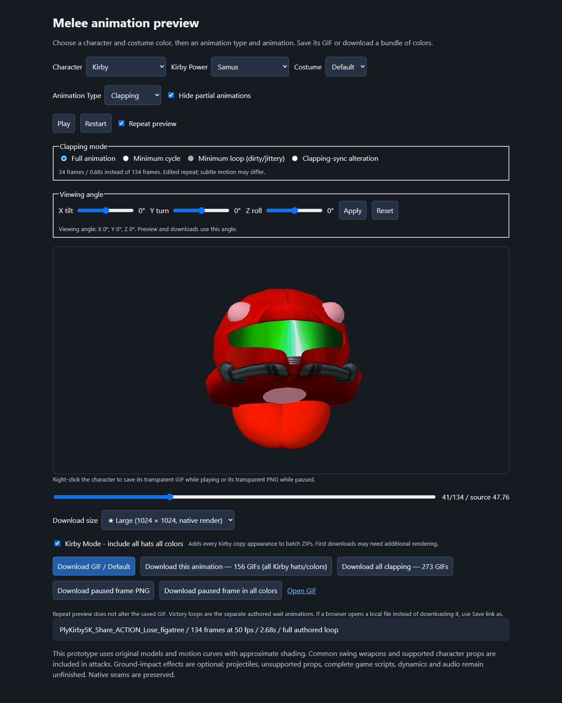

# Melee Decomp Animation UI

Turn Super Smash Bros. Melee animations into transparent GIFs and PNGs. This tool builds on the Melee decompilation: import assets from your own game ISO, choose a character and costume, play an animation, rotate the view, and download the animation or a single paused frame. Setup launchers are available for Windows, macOS and Linux. Windows uses a fast native renderer; Mac and Linux use the slower portable Python renderer.

> [!WARNING]
> **I developed and tested this project on Windows. Until I update this notice, the Mac and Linux setup scripts and UI launchers are untested on those operating systems.** The setup and launch code is straightforward and should work, but I haven't verified it on a Mac or Linux machine yet.

> [!WARNING]
> **Plan for roughly 75 GB — SEVENTY-FIVE GIGABYTES — of local project data.** The author's checkout measured 73.7 GB (79,148,052,480 bytes) after the larger renders, including generated assets, rather than the size of the source download. Importing and rendering creates extracted files, PNG frames, GIFs, ZIP bundles and caches. More animations, Kirby hats, viewing angles and larger native renders increase it further. Leave additional free space for preparation and downloads.


## What you can make

- Transparent animated **GIFs**, or **PNG stills** from the exact frame you pause on.
- The selected costume, every actual costume color, or a matching animation across characters.
- Victory poses, taunts, clapping, attacks, movement, sleep, rolls and knockdowns. Zelda and Sheik are separate entries; Ice Climbers render together.
- Kirby with any supported copy hat or replacement body, in each of his six colors.
- Views rotated on the X, Y and Z axes, with the same angle in your downloads.

Downloads show a progress bar with animation/file counts and frame counts while rendering or preparing GIFs. Once preparation reaches100%, your browser saves the finished file.

Animations share the game's results-screen light settings, so material highlights stay consistent across animation types. Materials designed to be unlit retain that appearance. Gameplay lighting varies by stage.

The roster also includes Giga Bowser, both wireframes, Master Hand, Crazy Hand and Sandbag. The Male Wireframe can also perform Captain Falcon's, Ganondorf's and Marth's victory poses and taunts plus Falcon's clap. The Female Wireframe can perform Sheik's, Samus's and Peach's, plus Sheik's clap; both wireframe claps also support the synced-clap mode. These are mapped onto the wireframe skeleton; the original game never shows them. Selected attacks include held items, character props and special effects. Multipart moves have combined playback presets, with their individual phases hidden by default. Lighting, effects and some runtime behavior remain approximate. **MP4 export is still future work.**

Game & Watch uses the game's original outline meshes, so his border scales with the character and remains visible in smaller exports. Kirby's Game & Watch appearance uses its own original outline meshes too.

Game & Watch's supported attacks now include their original spray, torch, turtle, parachute, manhole, air puff, pan, chair/key, bucket, oil spill and rescue props. Judgment's grounded/aerial choices show the appropriate numbered sign and hammer. For **Judgment 9**, **Electric hit explosion (9)** starts checked; switch it off to export the move alone. The burst previews a hit at the hammer strike using original particle sprites, with a deterministic contact preset rather than an opponent simulation. The setting carries through stills, GIFs, colors and rotated downloads.

| Victory pose | Clapping | A paused frame |
| --- | --- | --- |
|  |  |  |

These examples come from the actual renderer and are downsampled for this README. Full-resolution exports are generated locally from your ISO.

<details>
<summary>See Kirby's power selector and batch options</summary>



</details>

## Set up on Windows, Mac or Linux

### 1. Download the repository

Download and extract the entire repository, or clone it with Git. Keep its folders together and run it from the extracted folder, rather than inside a ZIP.

Use the setup launcher for your operating system:

| System | Setup/import | Reopen the player |
| --- | --- | --- |
| Windows | [Windows Setup - Import Melee Iso.cmd](Windows%20Setup%20-%20Import%20Melee%20Iso.cmd) | [Open Melee Decomp Animation UI.cmd](Open%20Melee%20Decomp%20Animation%20UI.cmd) |
| Mac | [Mac Setup - Import Melee Iso.command](Mac%20Setup%20-%20Import%20Melee%20Iso.command) | [Mac Open Melee Decomp Animation UI.command](Mac%20Open%20Melee%20Decomp%20Animation%20UI.command) |
| Linux | [Linux Setup - Import Melee Iso.sh](Linux%20Setup%20-%20Import%20Melee%20Iso.sh) | [Linux Open Melee Decomp Animation UI.sh](Linux%20Open%20Melee%20Decomp%20Animation%20UI.sh) |

Setup looks for **64-bit Python 3.10–3.13**, preferring 3.13. If none is available, Windows uses [Windows Package Manager](https://learn.microsoft.com/en-us/windows/package-manager/winget/install), Mac uses an existing [Homebrew installation](https://formulae.brew.sh/formula/python@3.13), and Linux supports apt-based Debian/Ubuntu and dnf-based Fedora distributions. Linux may request your administrator password to install Python/venv. The scripts do not replace your system Python or add package repositories. If the package manager or compatible packages are unavailable, setup stops with manual installation instructions. Python 3.14+ is not supported by these pinned dependencies.

For manual installation, use [Python's Windows downloads](https://www.python.org/downloads/windows/) (enable **Add Python to PATH**), [Python's Mac downloads](https://www.python.org/downloads/macos/), or your Linux distribution's packages including `venv`/`ensurepip`. An existing compatible Python works on other Linux distributions too.

The import launcher creates a local **`.venv`** and installs **NumPy 2.2.4** and **Pillow 11.1.0** there. Internet access is needed for initial package installation. Versions are pinned in [requirements.txt](tools/melee_anim/requirements.txt). A virtual environment cannot be shared between operating systems; create a separate checkout or rename an incompatible `.venv` before setup.

**Blender, Dolphin, FFmpeg, Node and a game compiler are not needed for the current UI or GIF/PNG exports.** Windows rendering uses Windows OpenGL. Mac/Linux rendering uses the existing NumPy/Pillow backend, without an OpenGL dependency. Full-roster preparation and HD stills can be substantially slower on this backend, and pixels can differ between renderers. Node is only used for developer tests. Use a normal browser to open the player; a Linux desktop/browser is needed to open it automatically, or use `--no-browser` and the printed URL.

### 2. Put your ISO in the root folder

Name your own game dump **`melee.iso`** and place it beside this README:

```text
melee-decomp-animations/
    README.md
    Windows Setup - Import Melee Iso.cmd
    Mac Setup - Import Melee Iso.command
    Linux Setup - Import Melee Iso.sh
    Open Melee Decomp Animation UI.cmd
    melee.iso                         <- your game dump
    tools/
    src/
    config/
```

Enable **File Explorer → View → Show → File name extensions** to check that the name is `melee.iso`, rather than `melee.iso.iso`.

The importer requires **NTSC-U Melee 1.02 / GALE01 revision 2**, with executable SHA-1 `08e0bf20134dfcb260699671004527b2d6bb1a45`. It checks the executable before extraction. Use a raw ISO/GCM image; compressed RVZ/GCZ/NKit images are unsupported. Changing their filename extension does not convert them.

The ISO and bulk extracted/rendered assets are ignored by Git and stay on your computer. Game files are not supplied with this repository.

### 3. Run your platform's setup/import launcher

On **Windows**, double-click **Windows Setup - Import Melee Iso.cmd** in File Explorer. On **Mac**, double-click **Mac Setup - Import Melee Iso.command** in Finder. If it is not executable after downloading, use Terminal from the repository folder:

```sh
sh './Mac Setup - Import Melee Iso.command'
```

On **Linux**, open a terminal in the repository folder and run:

```sh
sh './Linux Setup - Import Melee Iso.sh'
```

These commands work without changing executable permissions. For Mac Finder double-clicking after a ZIP download, first run `chmod +x './Mac Setup - Import Melee Iso.command' './Mac Open Melee Decomp Animation UI.command'`. There is no separate extraction app to install or open. After Python is available, setup:

1. Verifies and extracts the ISO into `orig/GALE01/files` and `orig/GALE01/sys`.
2. Prepares the Python packages and character/costume/action catalogs.
3. Renders the original 984 victory/taunt/clapping costume previews and 123 synchronized claps, then pre-renders the wireframes' 43 borrowed poses.
4. Builds the player and download bundles, then verifies the outputs.

**The first build takes considerable time and disk space.** Leave the window open until **“Import complete”** appears. Additional actions and variants render on demand when selected or downloaded. If preparation fails or is interrupted, fix the reported issue and run the same launcher again; completed matching jobs are reused.

To extract only, open PowerShell in the repository folder and run:

```powershell
& '.\Windows Setup - Import Melee Iso.cmd' --extract-only
```

On Mac/Linux, append `--extract-only` to the appropriate `sh` command instead. You can also pass a quoted ISO path and `--jobs 1` to reduce concurrent rendering. Extraction alone uses the Python standard library and does not install NumPy/Pillow or prepare the UI. Run the full import afterward.

### 4. Open the player

On Windows, double-click **[Open Melee Decomp Animation UI.cmd](Open%20Melee%20Decomp%20Animation%20UI.cmd)**. On Mac, double-click **Mac Open Melee Decomp Animation UI.command** or run `sh './Mac Open Melee Decomp Animation UI.command'`. On Linux, run `sh './Linux Open Melee Decomp Animation UI.sh'`. Each starts or reuses this checkout's local server and opens **[http://127.0.0.1:8765/player.html](http://127.0.0.1:8765/player.html)** in your browser.

Use this shortcut each time you want the UI. It opens a versioned player URL so updated controls load after the player HTML is regenerated. It does not import the ISO or rebuild the entire collection. The background server keeps running after its launcher window closes; a later launch starts it again if necessary.

## Use the player

Choose **Character**, optional **Kirby Power**, and **Costume**, then **Animation Type** and **Animation**. The animation selector appears when the type offers multiple choices. **Hide partial animations** starts checked; uncheck it to see combined moves alongside their separate phases.

**Repeat preview** starts on. Pause or scrub to a frame, then download its PNG. Right-clicking the preview saves the GIF while playing or the exact PNG while paused. Adjust the X/Y/Z sliders and click **Apply** to render a different view; **Reset** returns to the original angle. The sliders have magnetic stops every 45° from −180° to +180°. Enter an exact angle in the adjacent number box, or use the slider's arrow keys for 1° steps. New views are cached after rendering.

While paused, the purple **Rerender Selected Frame In HD** button renders that pose directly from the original model; the dark-purple **Rerender Selected Frame In HD In All Colors** button creates a ZIP for every actual costume. **HD PNG size** defaults to **4096 × 4096**, with **2048 × 2048** also available. Both buttons show the loading spinner and preparation progress, preserving the selected frame, applied angles, framing, props, effects and Kirby appearance. These transparent PNGs use the original textures; higher raster resolution does not add source texture detail. Exports use temporary storage outside the project and expire after 10 minutes; save the browser download to keep it. No prebuilt HD animation collection is needed.

**Crop Transparent Border**, after the purple buttons, starts checked. Each HD PNG is rendered at the selected resolution first, then cropped to the smallest rectangle containing all pixels with nonzero alpha. Pixel detail and partial transparency are preserved; the delivered dimensions can be smaller and need not be square. All-color ZIP members are cropped individually. Uncheck it to keep the full 4096 × 4096 (or 2048 × 2048) canvas.

Attack rotations use the prepared animation's saved source timing, while an HD request can generate its selected frame directly from the catalog without first storing a full animation at HD size.

| Option | What it does |
| --- | --- |
| Clapping modes | Original animation, minimum cycle, dirty/jittery cut, or the 0.84-second clapping-sync alteration. |
| Ground-impact effects | Fits the complete Knockdown impact when on; zooms in to fit the character alone when off. Fighter flashes remain. |
| Keep character centered | Follows full/short hops without changing their source poses or timing. |
| Download all colors | Saves the selected animation in every actual costume variant. |
| Download All | Victory Pose includes all three entrances and waits across characters/colors. Clapping and Taunt stay within their type. Attacks use the matching move family, including grounded/aerial versions and combined moves where available. |
| Kirby Mode - include all hats all colors | Adds every Kirby appearance and all six colors to batch ZIPs. Individual downloads retain the selected appearance. |

Batch buttons show a spinner while preparing files and prevent duplicate requests. Large first-time batches may need substantial additional rendering.

## Resolution and storage choices

I chose **512 × 512 as the native render size for most animations** to balance project size with useful image quality. I chose **1024 × 1024 for taunts, victory poses and clapping**, because those are the images I expect to use most myself. Synchronized claps and rotated/Kirby versions follow the same type-based policy.

Standard downloads offer **128, 256, 512, 1024 and 2048px** square images. A **★** marks the selected type's native size: **512 for most types, 1024 for Taunt, Victory Pose and Clapping**. Smaller exports downsample. Larger standard exports upscale the native image, adding dimensions without extra detail. The separate purple HD buttons render a single PNG at native **4096px** (or **2048px**) from the model. The UI explains standard upsizing and shows a dark-yellow large-GIF warning for 2048px.

To make a smaller collection—or spend the same space on higher native resolution—limit the characters, actions, colors and cached views you render. Adding all Kirby powers and colors roughly doubled my earlier storage estimate. Rendering his 25 copied appearances in all six colors adds **150 extra appearance/color variants per animation**, so omitting unneeded hats can save substantial space. The current estimate is about **75 GB**, and higher-resolution builds will increase it. CLI render commands accept `--size` for custom builds; keep custom outputs separate from the standard player collection unless you also update its resolution policy.

## Troubleshooting and manual setup

- **Python not found:** rerun setup to try your supported package manager, or manually install 64-bit Python 3.13. Windows searches `.venv`, `py -3.13`, `python` and the normal per-user Python 3.13 location. Mac/Linux search `.venv`, `python3.13` through `python3.10`, then `python3` and common Mac install locations. Set `MELEE_PYTHON` to an interpreter path for a custom Mac/Linux installation.
- **Packages fail to install:** check your internet connection and the error in the import window. If `.venv` uses incompatible Python, rename it and run import again.
- **ISO rejected:** check its filename, location, raw image format and revision. The importer reports the reason.
- **Animations not prepared:** run the full import, rather than `--extract-only`.
- **Controls or sizes look outdated:** finish the import/rebuild, restart the player server after code updates, and refresh with **Ctrl+Shift+R**. Opening the UI shortcut alone does not rebuild `player.html`.
- **UI fails to start:** read `build/melee_anim/player-server.log`. For a port conflict, run `& '.\Open Melee Decomp Animation UI.cmd' --port 8766`.

To set up from PowerShell instead of the shortcuts:

```powershell
py -3.13 -m venv .venv
.\.venv\Scripts\python.exe -m pip install --only-binary=:all: -r tools/melee_anim/requirements.txt
.\.venv\Scripts\python.exe -m tools.melee_anim.launcher import
.\.venv\Scripts\python.exe -m tools.melee_anim.launcher open
```

No environment activation or execution-policy changes are required. You can supply another ISO path: `& '.\Windows Setup - Import Melee Iso.cmd' 'D:\Game Dumps\Melee.iso'`.

The equivalent manual setup on Mac/Linux, with a compatible Python already installed, is:

```sh
python3.13 -m venv .venv
.venv/bin/python -m pip install --only-binary=:all: -r tools/melee_anim/requirements.txt
.venv/bin/python -m tools.melee_anim.launcher import
.venv/bin/python -m tools.melee_anim.launcher open
```

Use your installed compatible version in place of `python3.13` if needed. To choose a different port, append `--port 8766` to your platform's UI opener. To run the server in the foreground on Mac/Linux, use `.venv/bin/python -m tools.melee_anim.player_server --port 8766`.

For a foreground server you can stop with **Ctrl+C**:

```powershell
.\.venv\Scripts\python.exe -m tools.melee_anim.player_server --port 8766
```

Then open `http://127.0.0.1:8766/player.html`. Closing a browser tab does not stop a background server; its PID is printed by the launcher.

## Project background

Built on [doldecomp/melee](https://github.com/doldecomp/melee). The original README is preserved in [UPSTREAM-DECOMPILATION.md](.github/UPSTREAM-DECOMPILATION.md); this root README describes the animation tool. Original source attribution and licenses remain in the repository.

Architecture, verified mappings, remaining fidelity work and developer handoff notes are in [INVESTIGATION.md](INVESTIGATION.md), [PLAN.md](PLAN.md), [TODO.md](TODO.md) and [AGENTS.md](AGENTS.md). ISO data, bulk assets, masters, caches, bundles and logs remain under ignored `orig/`, `build/` and `.venv/`. Only a few curated README examples and screenshots are included under `docs/media`.
